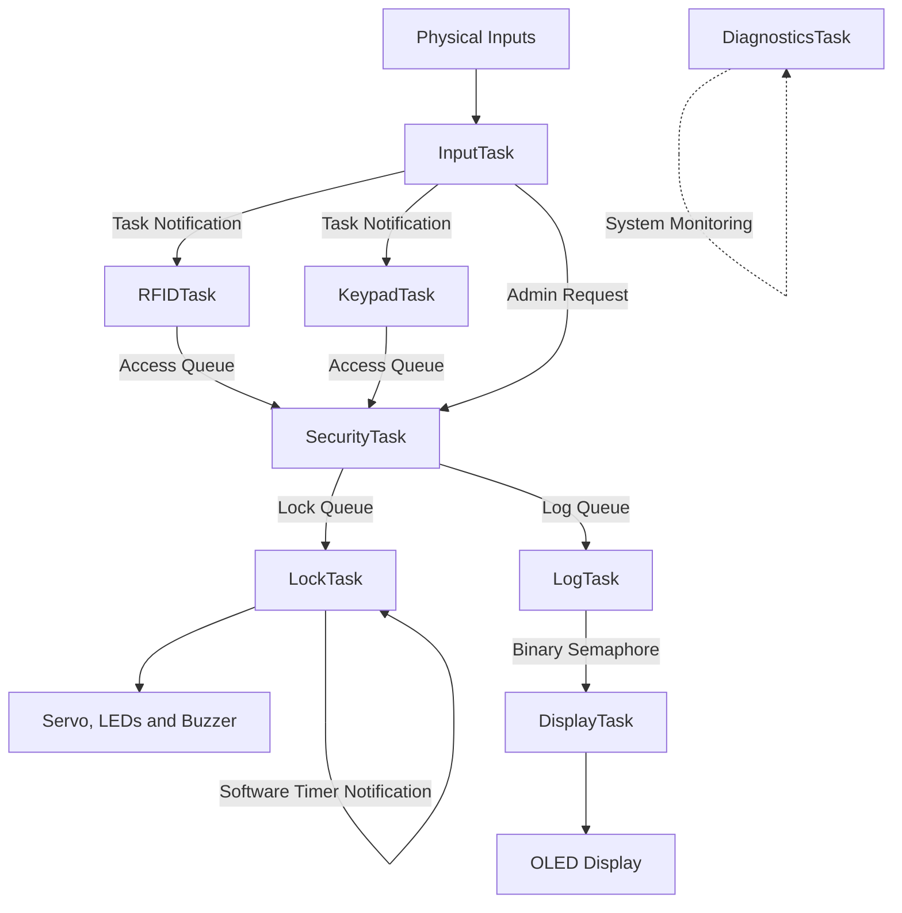

# ESP32 FreeRTOS Smart Lock System

A multitasking smart door-lock system built using the **ESP32 and FreeRTOS**. The system supports RFID authentication, keypad-based PIN authentication, administrator override, automatic relocking, access logging, and real-time status monitoring through an OLED display.

The primary objective of this project is to demonstrate how a Real-Time Operating System (RTOS) can be used to manage multiple concurrent operations in an embedded security system.

---

## 1. Project Overview

Traditional microcontroller programs often execute operations sequentially inside a single loop. This can become difficult to manage when several independent operations must happen simultaneously.

For example, a smart lock needs to:

- Monitor physical input buttons.
- Read RFID cards.
- Accept keypad PINs.
- Validate authentication requests.
- Control the servo-based locking mechanism.
- Maintain access history.
- Update the OLED display.
- Monitor system health.

This project uses **FreeRTOS on the ESP32** to divide these operations into independent tasks.

Each task is responsible for a specific function, and tasks communicate using RTOS synchronization mechanisms such as queues, mutexes, semaphores, and task notifications.

## 2. Features

- **RFID Authentication:** Uses an MFRC522 RFID reader to identify authorized cards.
- **Keypad Authentication:** Accepts a 4-digit PIN through a 4×4 keypad.
- **Admin Override:** Allows administrator access through a physical button held for 2 seconds.
- **Automatic Relocking:** Automatically locks the system after a configurable timeout.
- **Servo-Based Lock:** Uses an SG90 servo to control the lock position.
- **OLED Monitoring:** Displays lock status, authentication counters, and recent activity.
- **LED Indicators:** Green indicates unlocked; red indicates locked.
- **Buzzer Feedback:** Provides audible feedback for successful and unsuccessful authentication.
- **Access Logging:** Maintains the latest 10 access events in a circular buffer.
- **Periodic Access Summary:** Displays the latest successful entry for 10 seconds every 30 seconds.
- **System Diagnostics:** Monitors heap memory, queue usage, stored logs, and task stack usage.

## 3. Hardware Requirements

| Component | Purpose |
|---|---|
| ESP32 Dev Module | Main microcontroller and RTOS platform |
| MFRC522 RFID Reader | RFID authentication |
| 4×4 Matrix Keypad | PIN authentication |
| SSD1306 OLED (128×64) | System status and access information |
| SG90 Servo Motor | Locking mechanism |
| Push Buttons × 3 | RFID, PIN, and admin inputs |
| Red LED | Locked indication |
| Green LED | Unlocked indication |
| Buzzer | Audio feedback |
| 10kΩ Resistors | External button pull-ups |
| Regulated 5V Supply | Servo power |
| Breadboard and jumper wires | Circuit connections |

## 4. Software Requirements

- Arduino IDE
- ESP32 board support package
- FreeRTOS (included with the ESP32 Arduino framework)

### Required libraries

Install these libraries through the Arduino IDE Library Manager:

1. MFRC522
2. Keypad
3. Adafruit GFX Library
4. Adafruit SSD1306
5. ESP32Servo

## 5. Hardware Connections

### RFID RC522

| RC522 Pin | ESP32 GPIO |
|---|---:|
| SDA / SS | GPIO 5 |
| SCK | GPIO 18 |
| MOSI | GPIO 23 |
| MISO | GPIO 19 |
| RST | GPIO 27 |
| 3.3V | 3.3V |
| GND | GND |

### OLED Display

| OLED Pin | ESP32 GPIO |
|---|---:|
| SDA | GPIO 21 |
| SCL | GPIO 22 |
| VCC | Suitable module supply |
| GND | GND |

I2C address: `0x3C`

### Servo Motor

| Servo Wire | Connection |
|---|---|
| Signal | GPIO 13 |
| VCC | External regulated 5V |
| GND | External supply GND and ESP32 GND |

**Important:** Do not power the servo directly from the ESP32 3.3V pin. Use a suitable external 5V supply and connect the grounds together.

### LEDs and Buzzer

| Component | ESP32 GPIO |
|---|---:|
| Green LED | GPIO 2 |
| Red LED | GPIO 15 |
| Buzzer | GPIO 12 |

Use suitable current-limiting resistors for the LEDs. A transistor driver is recommended for a buzzer that exceeds the GPIO current rating.

### Push Buttons

| Button | ESP32 GPIO |
|---|---:|
| RFID Button | GPIO 34 |
| PIN Button | GPIO 35 |
| Admin Button | GPIO 39 |

These GPIO pins do not have internal pull-up resistors. Each requires an external 10kΩ pull-up to 3.3V, with the button connecting the GPIO to GND.

Expected logic:

- Button released: HIGH
- Button pressed: LOW

### 4×4 Keypad

| Keypad Pins | ESP32 GPIO |
|---|---|
| Row 1–4 | 4, 14, 16, 17 |
| Column 1–4 | 26, 25, 33, 32 |

## 6. Why FreeRTOS Is Used

The most important aspect of this project is its use of **FreeRTOS for concurrent task execution and resource management**.

Without an RTOS, the application would need to handle authentication, display updates, logging, and servo control through a single sequential loop. Long-running operations could delay other functions.

FreeRTOS solves this by dividing the application into independent tasks. The scheduler manages their execution according to priority and readiness.

For example:

- The RFID task can wait for a card without blocking the keypad task.
- The display task can update the OLED independently of authentication.
- The logging task can process access events without making the security task directly manipulate the history buffer.
- The lock task can manage the servo while other tasks continue executing.

This provides a modular architecture that is easier to maintain, debug, and extend.

## 7. FreeRTOS Task Architecture

The project uses **eight FreeRTOS tasks**, pinned to ESP32 Core 1.

| Task | Priority | Responsibility |
|---|---:|---|
| InputTask | 3 | Monitors and debounces physical buttons |
| RFIDTask | 2 | Reads RFID cards and validates their UID |
| KeypadTask | 2 | Collects and validates keypad PIN input |
| SecurityTask | 4 | Makes final authentication and access decisions |
| LockTask | 3 | Controls servo, LEDs, buzzer, and auto-relocking |
| LogTask | 1 | Maintains access history and prints logs |
| DisplayTask | 1 | Updates OLED display |
| DiagnosticsTask | 1 | Monitors memory, queues, logs, and task stacks |

### Task responsibilities

**1. InputTask**

Continuously monitors the three physical buttons. It performs software debouncing and sends task notifications to RFIDTask or KeypadTask when their corresponding buttons are pressed.

The admin button requires a continuous 2-second press before an override request is submitted.

**2. RFIDTask**

Waits for a notification from InputTask. Once activated, it waits for an RFID card, reads its UID, compares it with the configured authorized UID, and sends the result to SecurityTask.

**3. KeypadTask**

Waits for a notification before starting a PIN-entry session. It accepts numeric input, uses `*` to clear the entered PIN, and `#` to submit it.

The session automatically expires after 15 seconds.

**4. SecurityTask**

Acts as the central decision-making unit.

It receives authentication requests from the access queue and checks:

- Whether the supplied credential is valid.
- Whether a security lockout is active.
- Whether the request is an administrator override.
- Whether the failed-attempt threshold has been reached.

It then sends commands to LockTask and access records to LogTask.

**5. LockTask**

Owns the normal operation of the servo, LEDs, and buzzer.

It receives commands from SecurityTask, unlocks the mechanism after successful authentication, and handles automatic relocking when the software timer expires.

**6. LogTask**

Receives access records and stores them in a circular buffer. It retains the latest 10 events, overwriting the oldest record when the buffer becomes full.

It also signals DisplayTask when a new access event is recorded.

**7. DisplayTask**

Refreshes the OLED every 500 milliseconds or when a new access log is available.

It displays the current lock state, authentication counters, and the latest successful access summary.

**8. DiagnosticsTask**

Runs periodically every 5 seconds and prints system-health information, including free heap memory, minimum free heap, queue occupancy, log count, and task stack high-water marks.

## 8. FreeRTOS Concepts Implemented

This project demonstrates several important RTOS concepts.

### 8.1 Tasks and Multitasking

Each major subsystem is implemented as an independent FreeRTOS task using:

`xTaskCreatePinnedToCore()`

Tasks are assigned different priorities depending on their importance.

For example, SecurityTask has priority 4, while LogTask, DisplayTask, and DiagnosticsTask have priority 1.

A higher-priority Ready task gets CPU time before a lower-priority Ready task. A task that is blocked while waiting for a queue or notification does not continuously consume CPU time.

### 8.2 Task Scheduling and Priorities

The FreeRTOS scheduler decides which Ready task executes.

The project uses the following priority structure:

- Priority 4: SecurityTask
- Priority 3: InputTask and LockTask
- Priority 2: RFIDTask and KeypadTask
- Priority 1: LogTask, DisplayTask, and DiagnosticsTask

This prioritizes security decisions and physical input handling over background logging and display operations.

All eight application tasks are pinned to Core 1 in this implementation.

### 8.3 Queues

Queues provide safe communication between tasks by transferring copies of data.

Three queues are implemented:

| Queue | Communication | Purpose |
|---|---|---|
| `accessQueue` | RFIDTask / KeypadTask / InputTask → SecurityTask | Transfers authentication requests |
| `lockQueue` | SecurityTask → LockTask | Transfers lock commands |
| `logQueue` | SecurityTask → LogTask | Transfers access log records |

For example, when an RFID card is scanned, RFIDTask does not directly unlock the servo. Instead, it sends an authentication request to SecurityTask through `accessQueue`.

SecurityTask makes the final decision and sends an unlock command through `lockQueue`.

This separation keeps authentication decisions independent of hardware control.

### 8.4 Mutexes

Mutexes protect shared resources from simultaneous access.

Two mutexes are implemented:

| Mutex | Protected resource |
|---|---|
| `stateMutex` | Shared application state |
| `logMutex` | Access history and latest successful entry |

For example, SecurityTask updates the lock state and authentication counters, while DisplayTask reads this information.

Without synchronization, one task could read partially updated data while another task is modifying it.

The mutex ensures that only one task accesses the protected resource at a time.

FreeRTOS mutexes also support priority inheritance, which helps reduce priority inversion.

### 8.5 Binary Semaphore

The project uses:

`logUpdatedSemaphore`

LogTask gives the semaphore after recording a new access event.

DisplayTask waits for this semaphore and refreshes the OLED when it receives the signal. It also wakes up periodically after a 500 ms timeout.

This allows event-driven display updates without requiring LogTask to directly control the OLED.

### 8.6 Task Notifications

Task notifications provide lightweight communication between tasks.

They are used in two places:

- InputTask notifies RFIDTask when the RFID button is pressed.
- InputTask notifies KeypadTask when the PIN button is pressed.
- The software timer callback notifies LockTask when the auto-relock timer expires.

RFIDTask and KeypadTask can remain blocked until they receive a notification instead of continuously polling for activation.

### 8.7 Software Timers

The project uses a one-shot FreeRTOS software timer named `unlockTimer`.

When authentication succeeds:

1. SecurityTask sends an unlock command.
2. LockTask moves the servo to the unlocked angle.
3. LockTask starts or restarts the software timer.
4. When the timer expires, its callback notifies LockTask.
5. LockTask moves the servo back to the locked angle.

The timer callback only sends a task notification. It does not directly control the servo.

The configured duration is controlled by:

```cpp
#define UNLOCK_TIME_MS 5000
```

This currently represents 5 seconds. Change it to `1000` for 1 second or `300000` for 5 minutes.

### 8.8 Periodic Task Execution

DiagnosticsTask uses `vTaskDelayUntil()` to execute at a fixed 5-second interval.

Unlike a simple relative delay, `vTaskDelayUntil()` schedules execution based on the previous wake time, making it suitable for periodic tasks.

### 8.9 Shared Resource Protection and Priority Inheritance

The project uses mutexes to protect shared data accessed by tasks with different priorities.

FreeRTOS mutexes support priority inheritance. If a lower-priority task holds a mutex required by a higher-priority task, the lower-priority task can temporarily inherit the higher priority so it can finish its critical section sooner.

This reduces the risk of priority inversion delaying important operations.

---

## 9. System Workflow

The general authentication and control sequence is:

1. The user presses the RFID or PIN button.
2. InputTask detects the button press and notifies the appropriate task.
3. RFIDTask or KeypadTask collects the credential.
4. The authentication result is sent to SecurityTask through `accessQueue`.
5. SecurityTask checks the credential and lockout state.
6. SecurityTask sends the access result to LogTask and a lock command to LockTask.
7. LogTask records the event and signals DisplayTask.
8. LockTask operates the servo and indicators.
9. After the configured timeout, the software timer notifies LockTask to relock.

### Architecture diagram



## 10. Security Mechanisms

### Failed Authentication Lockout

The system allows a maximum of three consecutive failed authentication attempts.

After three failures:

- Lockout is activated.
- Further normal authentication requests are denied during the lockout period.
- The lockout lasts 20 seconds.
- Failed-attempt count is reset when lockout is activated.

### Administrator Override

The admin button provides a physical override mechanism.

It requires a continuous 2-second button hold. The administrator request clears the lockout and grants access.

**Note:** This is a demonstration override mechanism, not production-grade administrator authentication.

## 11. Access Logging

The system maintains a circular buffer with a capacity of 10 events.

Each record contains:

- Authentication source (RFID, keypad, or admin).
- Access result (granted or denied).
- System uptime timestamp.
- Event message.

When the buffer is full, the oldest event is overwritten.

The latest successful access is also stored separately for display on the OLED.

All logs are currently stored in RAM. They are lost when the ESP32 restarts or loses power.

## 12. System Diagnostics

DiagnosticsTask periodically reports:

| Parameter | Purpose |
|---|---|
| Free heap | Available dynamic memory |
| Minimum free heap | Lowest recorded free heap |
| Queue waiting messages | Current queue occupancy |
| Stored access events | Number of recorded log entries |
| Task stack high-water marks | Remaining stack capacity for each monitored task |

These measurements help identify memory pressure, queue congestion, and potential task stack issues.

Stack high-water marks are reported in words, not bytes. A smaller value indicates less remaining stack space.

## 13. Configuration

Important settings can be changed in the system configuration section of the source code.

| Configuration | Current value | Description |
|---|---:|---|
| `SERVO_LOCKED_ANGLE` | 10° | Locked servo position |
| `SERVO_UNLOCKED_ANGLE` | 90° | Unlocked servo position |
| `UNLOCK_TIME_MS` | 5000 ms | Automatic relock delay |
| `PIN_SESSION_MS` | 15000 ms | PIN-entry timeout |
| `ADMIN_HOLD_MS` | 2000 ms | Admin button hold duration |
| `MAX_FAILED_ATTEMPTS` | 3 | Failed attempts before lockout |
| `LOCKOUT_TIME_MS` | 20000 ms | Lockout duration |
| `LOG_CAPACITY` | 10 | Number of stored access events |
| `LOG_SUMMARY_INTERVAL_MS` | 30000 ms | Summary display interval |
| `LOG_SUMMARY_DURATION_MS` | 10000 ms | Summary display duration |

### Change the credentials

Update the following values:

```cpp
const char DEMO_PIN[] = "2580";
const char ALLOWED_RFID_UID[] = "92AC491D";
```

Replace the RFID UID with the UID of your authorized card.

## 14. How to Run

1. Install the Arduino IDE.
2. Install ESP32 board support.
3. Install all required libraries.
4. Connect the hardware according to the pin configuration.
5. Verify the external pull-up resistors on GPIO 34, 35, and 39.
6. Update the RFID UID and PIN in the source code.
7. Select **ESP32 Dev Module** as the board.
8. Select the correct serial port.
9. Upload the sketch.
10. Open Serial Monitor at **115200 baud**.

After initialization, the system creates the RTOS synchronization objects, software timer, and eight FreeRTOS tasks.

The Arduino `loop()` does not perform application processing; the application runs inside the FreeRTOS tasks.

## 15. Limitations and Future Improvements

This implementation is a functional RTOS demonstration and prototype, not a production-ready access-control system.

Current limitations:

- Access credentials are hardcoded in the firmware.
- Admin override is based on a physical button, not secure administrator authentication.
- Access history is volatile and disappears after restart.
- Timestamps represent ESP32 uptime, not actual date and time.
- The servo position is commanded but not verified using a physical feedback sensor.
- The lockout and access-control state are maintained in RAM.
- No network-based monitoring or remote access management is implemented.
- A servo is used for demonstration; a production door lock would require a mechanically suitable locking mechanism.

Possible improvements:

- Store access history persistently using EEPROM emulation, NVS, or an SD card.
- Add an RTC or NTP synchronization for real timestamps.
- Implement secure credential management.
- Add door-position sensing using a magnetic reed switch.
- Add tamper detection and alarm handling.
- Introduce a web dashboard for remote monitoring.
- Add watchdog supervision and more comprehensive fault handling.

## 16. Learning Outcomes

Through this project, the following embedded systems and RTOS concepts are demonstrated:

- Multitasking and concurrent execution.
- Task creation, priorities, and scheduling.
- Inter-task communication using queues.
- Task synchronization using mutexes and semaphores.
- Lightweight task notifications.
- One-shot software timers.
- Periodic task execution.
- Shared resource protection.
- Priority inversion and priority inheritance concepts.
- Heap and task stack monitoring.
- Modular embedded system architecture.

## 17. Conclusion

The ESP32 FreeRTOS Smart Lock demonstrates how an RTOS can organize a multi-functional embedded security system into independent, cooperating tasks.

Instead of handling every operation sequentially, FreeRTOS allows authentication, access decisions, physical lock control, logging, display updates, and diagnostics to operate as separate tasks.

Queues provide structured communication, mutexes protect shared data, semaphores coordinate event-driven updates, task notifications activate waiting tasks, and software timers handle automatic relocking.

The project serves as a practical demonstration of how real-time operating system concepts can be applied to embedded systems that require coordinated handling of multiple hardware and software operations.

---

**Platform:** ESP32 Dev Module  
**Operating System:** FreeRTOS  
**Framework:** Arduino  
**Language:** C++  
**Project Type:** Embedded Systems / RTOS / Smart Access Control
